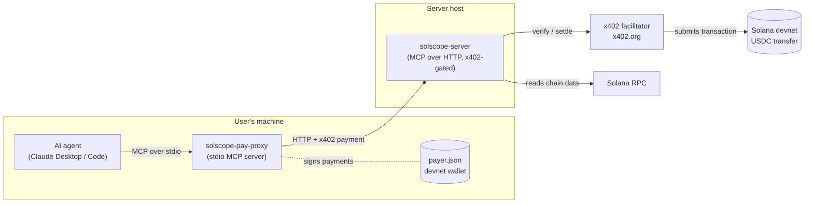
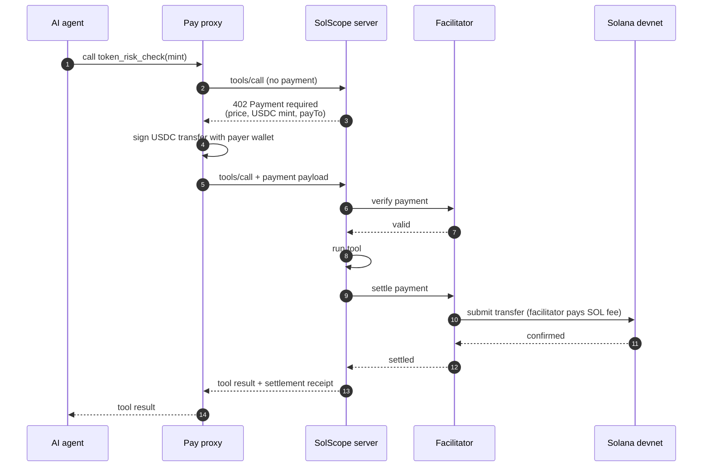

# SolScope

**Solana wallet and token intelligence for AI agents, sold per call in USDC.**

SolScope is an [MCP](https://modelcontextprotocol.io) server that gives AI agents (Claude Desktop, Claude Code, any MCP client) tools to inspect Solana wallets, explain transactions, assess token risk and more. Most tools are paid: the agent pays a few cents in USDC per call using the [x402](https://docs.x402.org) payment protocol, with no accounts, API keys, or subscriptions.

> **Note:** Payments run on Solana devnet and data comes from mainnet. Tool calls are paid in devnet USDC, which has no real value, so no real funds are involved. The wallet, token, and transaction data the tools return is read from Solana mainnet, so you can query real addresses and tokens.

---

## Contents

- [How it works](#how-it-works)
- [Tools and pricing](#tools-and-pricing)
- [Repository layout](#repository-layout)
- [Quick start](#quick-start)
- [Connect Claude Desktop](#connect-claude-desktop)
- [Testing with the MCP Inspector](#testing-with-the-mcp-inspector)
- [Adding a paid tool](#adding-a-paid-tool)
- [Security notes](#security-notes)
- [Troubleshooting](#troubleshooting)
- [Roadmap](#roadmap)

---

## How it works

Claude has no wallet, so it can't sign payments itself. SolScope ships two pieces:

- **`solscope-server`** is the MCP server. It exposes the tools over HTTP and charges for paid ones using x402.
- **`solscope-pay-proxy`** is a small local MCP server that runs on the user's machine. It holds the user's wallet, forwards every tool call to the remote server, and signs the USDC payment when a call needs one.

From the agent's point of view there is a single MCP server. Payment happens behind the scenes.

### Architecture



### Paid call flow



Free tools skip steps 2 to 3 and 5 to 11: the server answers immediately and nothing is paid.

---

## Tools and pricing

| Tool                     | What it does                                                                                                      | Price (USDC) |
| ------------------------ | ----------------------------------------------------------------------------------------------------------------- | ------------ |
| `get_wallet_snapshot`    | SOL balance and number of token accounts                                                                          | Free         |
| `get_wallet_portfolio`   | All non-zero token holdings with names and amounts                                                                | $0.005       |
| `explain_transaction`    | A signature turned into plain English: who sent what, which programs were involved, fees paid                     | $0.01        |
| `token_risk_check`       | Mint and freeze authority status, top-holder concentration, supply, and related heuristic checks                  | $0.02        |
| `wallet_activity_digest` | Summary of the last N transactions grouped into transfers, swaps and other activity, with frequent counterparties | $0.02        |

Prices are defined in one place, `solscope-server/src/x402.ts` (`TOOL_PRICES`). Risk scores, transaction categories, and counterparties are **heuristic**, and nothing here is investment advice.

---

## Repository layout

```
SolScope/
├── solscope-server/        # MCP server (deployed)
│   ├── src/
│   │   ├── index.ts        # Express app, tool registration, /mcp endpoint
│   │   ├── x402.ts         # Pricing table + registerPaidTool() helper
│   │   ├── mcp.ts          # MCP helpers
│   │   ├── rpc.ts          # Solana RPC client
│   │   ├── schemas.ts      # Zod input schemas for each tool
│   │   ├── config.ts       # Environment config
│   │   ├── tools/          # Tool implementations
│   │   ├── helpers/
│   │   └── types/
│   ├── .env.example
│   └── package.json
├── solscope-pay-proxy/     # Local payment proxy (runs on the user's machine)
│   ├── src/index.ts        # Transparent MCP passthrough with x402 auto-payment
│   ├── payer.json          # Devnet keypair. NEVER commit this.
│   └── package.json
└── LICENSE
```

---

## Quick start

### Prerequisites

- Node.js 20+ and [pnpm](https://pnpm.io)
- A [Solana CLI](https://docs.solana.com/cli/install-solana-cli-tools) install (for creating wallets and checking balances)
- A Solana devnet wallet to **receive** payments (your server's `payTo` address)
- A separate devnet wallet to **pay** (the proxy's `payer.json`), funded with devnet USDC

### 1. Create wallets

```bash
# Wallet that pays for tool calls (used by the proxy)
solana-keygen new --outfile solscope-pay-proxy/payer.json
solana address -k solscope-pay-proxy/payer.json
```

Fund the payer address with **devnet USDC** at <https://faucet.circle.com>. The payer does not need devnet SOL, because the facilitator sponsors the network fee.

For the receiving wallet, use any devnet address you control. It receives the USDC.

### 2. Run the server

```bash
cd solscope-server
cp .env.example .env     # then fill in the values, including the payTo address
pnpm install
pnpm build
pnpm start
```

You should see:

```
solscope-mcp-server listening on http://localhost:3000/mcp
```

### 3. Build the proxy

```bash
cd solscope-pay-proxy
pnpm install
pnpm build
```

---

## Connect Claude Desktop

Open **Claude, Settings, Developer, Edit Config** and add the proxy under `mcpServers`. Use **absolute paths**, because Desktop does not launch the proxy from your project folder.

```json
{
  "mcpServers": {
    "solscope": {
      "command": "node",
      "args": ["/absolute/path/to/SolScope/solscope-pay-proxy/dist/index.js"],
      "env": {
        "PAYER_KEYPAIR": "/absolute/path/to/SolScope/solscope-pay-proxy/payer.json",
        "SERVER_URL": "http://localhost:3000/mcp"
      }
    }
  }
}
```

1. Start the server first.
2. Fully quit Claude Desktop (Cmd+Q) and reopen it.
3. In a **new chat**, ask for a token risk check on a mint address and approve the tool call.

### Claude Code

```bash
claude mcp add solscope \
  -e PAYER_KEYPAIR=/absolute/path/to/payer.json \
  -e SERVER_URL=http://localhost:3000/mcp \
  -- node /absolute/path/to/SolScope/solscope-pay-proxy/dist/index.js
```

---

## Testing with the MCP Inspector

**Raw server** (paid tools will show the 402 challenge, since the Inspector can't pay):

```bash
npx @modelcontextprotocol/inspector
# Transport: Streamable HTTP, URL: http://localhost:3000/mcp
```

**Through the proxy** (real end-to-end payment):

```bash
cd solscope-pay-proxy
npx @modelcontextprotocol/inspector \
  -e PAYER_KEYPAIR=/absolute/path/to/payer.json \
  -e SERVER_URL=http://localhost:3000/mcp \
  node /absolute/path/to/SolScope/solscope-pay-proxy/dist/index.js
```

A successful payment lowers the payer's USDC balance by the tool price:

```bash
spl-token balance 4zMMC9srt5Ri5X14GAgXhaHii3GnPAEERYPJgZJDncDU \
  --owner <payer-address> --url devnet
```

---

## Adding a paid tool

1. Add the price to `TOOL_PRICES` in `solscope-server/src/x402.ts`.
2. Register the tool with `registerPaidTool` instead of `server.registerTool`:

```typescript
registerPaidTool(
  server,
  "my_new_tool",
  { description: "What it does.", inputSchema: myNewToolSchema },
  myNewTool,
);
```

The handler is a normal MCP tool callback and needs no changes. `registerPaidTool` adds the paywall, appends the price to the tool description, and adapts the MCP SDK context to what the x402 wrapper expects. The pay proxy discovers tools at runtime, so it needs no changes either.

---

## Troubleshooting

| Symptom                                                                  | Likely cause                                                                                                                                   |
| ------------------------------------------------------------------------ | ---------------------------------------------------------------------------------------------------------------------------------------------- |
| Paid tool returns "Payment required" in the Inspector (direct to server) | Expected. The Inspector can't pay. Test through the proxy.                                                                                     |
| Paid tool returns "Payment required" through the proxy                   | Payer has no devnet USDC, the server wasn't restarted after code changes, or the server isn't passing the payment context to the x402 wrapper. |
| Proxy log shows `paymentMade: true` but the call still fails             | The server or facilitator rejected the payment. Check the server terminal.                                                                     |
| Claude never calls a paid tool                                           | Start a **new chat** after changing tool descriptions, and state that the proxy handles payment.                                               |
| Server shows as failed in Desktop                                        | The proxy couldn't reach `SERVER_URL` at startup. Start the server first, then restart Desktop.                                                |
| `command not found: node` in Desktop                                     | Use the absolute path from `which node` as `command`.                                                                                          |

Proxy logs are written to stderr (never stdout, which is the MCP channel). On macOS, Desktop saves them at `~/Library/Logs/Claude/mcp-server-solscope.log`.

---

## Network reference (devnet)

|                  |                                                |
| ---------------- | ---------------------------------------------- |
| Network (CAIP-2) | `solana:EtWTRABZaYq6iMfeYKouRu166VU2xqa1`      |
| USDC mint        | `4zMMC9srt5Ri5X14GAgXhaHii3GnPAEERYPJgZJDncDU` |
| Facilitator      | `https://x402.org/facilitator`                 |
| Payment scheme   | `exact`                                        |

## License

See [LICENSE](./LICENSE).
